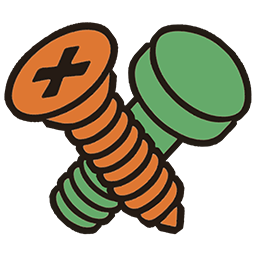

# Model Pack for Maya

Набор инструментов моделирования от **Black Cats Society**: Mirror Cut, Mirror Dup, Reset Tube, Hard Edges, Clone Slide, Slide Bevel, Bevel, UnBevel, Select и Plane Deform.



**Версия:** 0.1.0-beta. **Проверенная среда:** Windows, Autodesk Maya 2027. Используются Python, PySide6, shiboken6 и NumPy из Maya. Проверка других версий Maya пока не проведена.

## Установка

1. Откройте [Releases](https://github.com/Black-Cats-Society/ModelPack/releases) и скачайте **ModelPack_0.1.0-beta.zip** из Assets.
2. Полностью распакуйте ZIP в постоянную папку с латинским путём, например `C:/MayaTools`. Внутри будет папка **ModelPack_0.1.0-beta**. Пробелы в пути допустимы.
3. Запустите Maya и выберите вкладку **Shelf**, на которой нужна кнопка.
4. Перетащите **install_model_pack.py** из распакованной папки прямо в **3D viewport Maya**. Не перетаскивайте ZIP.
5. На выбранной полке появится кнопка **Model Pack / MP**, панель откроется автоматически.
6. В меню Shelf выберите **Save All Shelves**. После перезапуска запускайте панель кнопкой MP.

Установщик создаёт кнопку Shelf и файл `ModelPack.mod` в пользовательской папке `maya/modules`. Модуль делает скрипты и узлы истории доступными при следующем запуске Maya. Права администратора не нужны. Файлы остаются в распакованной папке; сохраняйте её на месте вместе с `icons/` и всеми модулями.

Можно установить из клона репозитория: перетащите `install_model_pack.py` из его корня. Готовый ZIP содержит комплект файлов с контрольными суммами.

### Если перетаскивание не сработало

Откройте **Windows → General Editors → Script Editor**, выберите вкладку **Python** и выполните код, заменив путь на свою распакованную папку:

```python
import runpy
runpy.run_path(r'C:\MayaTools\ModelPack_0.1.0-beta\install_model_pack.py', run_name='__main__')
```

## Использование

| Инструмент | Действие |
| --- | --- |
| Combine / Separate | Объединить меши / разделить по оболочкам |
| Extract Faces / Detach Faces | Извлечь / отделить выбранные грани |
| Mirror Cut / Mirror Dup | Отразить с разрезом / создать отражённую копию |
| Reset Tube | Изменить число сторон трубки по выбранному продольному шву |
| Hard Edges | Выбирать рёбра по углу; Harden Edge задаёт жёсткие нормали |
| Clone Slide / Slide Bevel | Создать и перемещать разрезы по выбранным рёбрам |
| Bevel / UnBevel | Создать фаску / найти и убрать фаски |
| Select | Команды выделения компонентов |
| Plane Deform | Деформировать выбранные рёбра, вершины или полигоны управляющей плоскостью |

Настройки открываются под основными кнопками. Повторное нажатие активной кнопки завершает инструмент.

### Mirror

- Плоскость и гизмо доступны всё время, пока включён Mirror. Стрелки перемещают плоскость, кольца вращают, квадраты X/Y/Z выбирают ось.
- Local начинает по pivot меша, включая Bake Pivot; World — по мировым осям.
- В Mirror Cut зелёные/красные кружки переключают положительную/отрицательную сторону. Mirror Dup использует только X/Y/Z.
- **V** — привязка к вершинам и пивотам; **X** — к сетке. Работают также Snap to Points и Snap to Grids.
- **Shift при вращении** — шаг 5°. Появившееся поле принимает точный угол относительно начала захвата; щёлкните в поле и нажмите Enter после ввода.
- **«+» / «−»** меняют размер гизмо. **Alt** — навигация камерой. **Esc** отменяет текущий жест.
- **W/R/E** позволяют редактировать меш, сохраняя гизмо плоскости.
- Пока Mirror Cut активен, Undo отменяет последнее действие. После выхода отражение применяется, а весь сеанс отменяется одним Undo.

### Clone Slide / Slide Bevel

Выберите рёбра и включите инструмент. Перетаскивание создаёт разрезы, нижняя панель меняет режим, количество и распределение. После отпускания мыши можно продолжать менять те же рёбра. Новое выделение или завершение инструмента заканчивает текущую правку.

### Bevel / UnBevel

Bevel работает на выбранных внутренних рёбрах. Ширина меняется при перетаскивании; Shift включает управление числом сегментов. Enter применяет фаску, Esc отменяет предпросмотр. Настройки профиля доступны через меню инструмента.

UnBevel поддерживает выбор граней и поиск фасок. При выборе грани фаски поиск ограничивается этой фаской, а повторный поиск использует сохранённые результаты.

## Обновление

1. Сохраните сцену и закройте Maya.
2. Замените весь комплект файлов новой версией, сохранив путь папки. Не смешивайте отдельные модули разных версий.
3. При изменении пути перетащите новый `install_model_pack.py` на ту же выбранную полку. Установщик обновит свою кнопку без дубля и перепишет путь модуля.
4. Сохраните Shelf.

Для повторного открытия панели после правок кода нажмите MP: кнопка использует загрузчик, обновляющий Python-модули. При переходе на другой путь и при обновлении плагинов узлов используйте перезапуск Maya.

## Удаление

Удалите кнопку MP с Shelf и сохраните полки. Закройте Maya, удалите `ModelPack.mod` из пользовательской папки `maya/modules`, затем удалите папку пакета.

Сцены с редактируемыми узлами Model Pack требуют его файлов. Перед удалением примените нужные инструменты и сохраните готовую геометрию.

## Если возникает ошибка

- **No module named ...**: проверьте, что весь пакет распакован и папка не перемещена. Повторите установку из действующей папки.
- **Нужна папка с латинским путём**: перенесите весь пакет в `C:/MayaTools` и повторите установку. Maya некорректно находит Python-плагины в путях с кириллицей при открытии сохранённых сцен; установщик проверяет путь до записи файлов и создания кнопки.
- **Файл повреждён или изменён**: скачайте и распакуйте ZIP заново. Для редактирования исходников используйте клон репозитория.
- **Предупреждение Maya о загрузке Python-плагина**: при первом использовании узлов Maya может попросить разрешение для файлов пакета. Разрешите загрузку, если это скачанный вами Model Pack.
- Если перетаскивание из Проводника не работает, используйте код Script Editor выше.
- Для сообщения о баге приложите версию Maya, инструмент, шаги воспроизведения и текст ошибки из Script Editor.

Проверки выполняются в Maya 2027 `mayapy`, включая геометрию, историю и Undo/Redo. События Qt проверяются с моделируемой камерой; ручная проверка каждой операции в интерактивном viewport остаётся отдельным этапом.

## Авторство

Комплект использует исходный `unBevel1.54.py` Joe Wu; его заголовок и сведения об авторе сохранены. См. [THIRD_PARTY_NOTICES.md](THIRD_PARTY_NOTICES.md).
